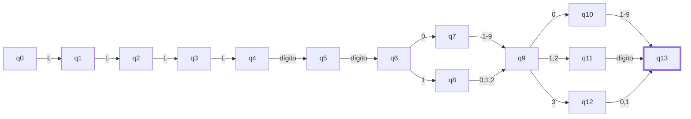

# AFD del RFC sin homoclave

Reconoce cadenas de la forma `LLLLAAMMDD`: cuatro letras mayúsculas, año de
dos dígitos, mes 01-12 y día 01-31.

## Expresión regular

```
[A-Z]{4}[0-9]{2}(0[1-9]|1[0-2])(0[1-9]|[12][0-9]|3[01])
```

## Definición formal M = (Q, Σ, δ, q0, F)

- **Q** = { q0, q1, …, q13 } y un estado muerto implícito
- **Σ** = { L, 0, 1, 2, 3, 4-9 }, donde L es cualquier letra A-Z y `4-9` agrupa los dígitos del 4 al 9
- **q0** = q0
- **F** = { q13 }
- **δ** = la tabla siguiente (lo que no aparece va al estado muerto)

## Tabla de transición

| Estado | L | 0 | 1 | 2 | 3 | 4-9 | Significado |
|---|---|---|---|---|---|---|---|
| q0  | q1 |  |  |  |  |  | inicio |
| q1  | q2 |  |  |  |  |  | 1 letra |
| q2  | q3 |  |  |  |  |  | 2 letras |
| q3  | q4 |  |  |  |  |  | 3 letras |
| q4  |  | q5 | q5 | q5 | q5 | q5 | 4 letras, espera año |
| q5  |  | q6 | q6 | q6 | q6 | q6 | 1.er dígito del año |
| q6  |  | q7 | q8 |  |  |  | año completo, espera mes |
| q7  |  |  | q9 | q9 | q9 | q9 | mes 0_ |
| q8  |  | q9 | q9 | q9 |  |  | mes 1_ |
| q9  |  | q10 | q11 | q11 | q12 |  | mes completo, espera día |
| q10 |  |  | q13 | q13 | q13 | q13 | día 0_ |
| q11 |  | q13 | q13 | q13 | q13 | q13 | día 1_ o 2_ |
| q12 |  | q13 | q13 |  |  |  | día 3_ |
| **q13** |  |  |  |  |  |  | **acepta** |

## Diagrama



## Limitación

El AFD no puede relacionar el día con el mes y el año: acepta `CUNG850230`
(30 de febrero) porque revisar eso exige comparar valores. Esa validación
corresponde al análisis semántico (regla S6).
